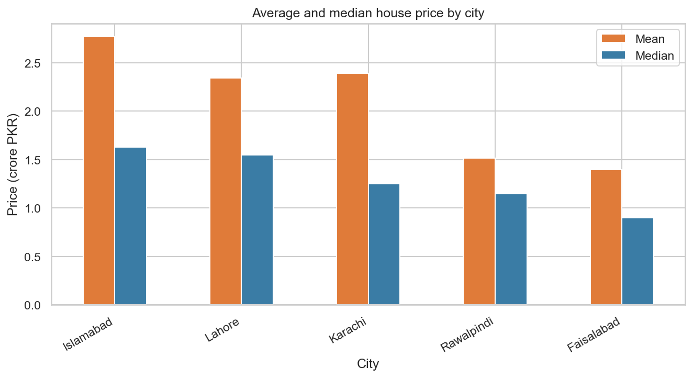
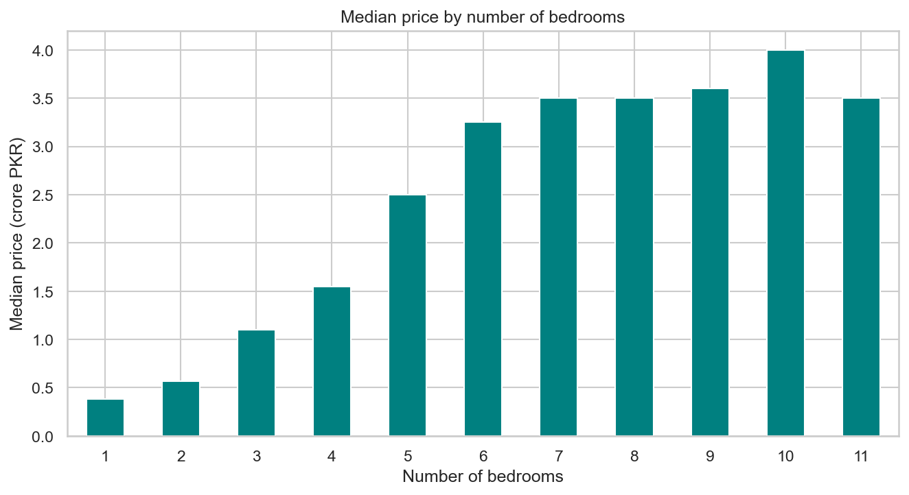
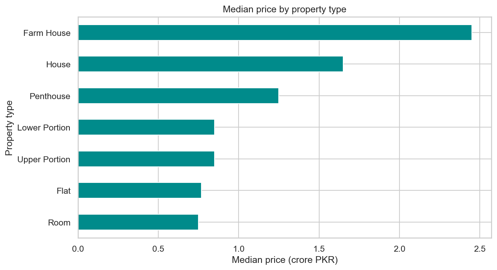

# pakistan-house-price-predictor

Predicts house **sale prices** in Pakistani cities from features such as area, bedrooms, bathrooms, property type and location.

**Status:** Data cleaning and exploratory analysis done. Model training is next.

**Planned pipeline:** trained model, FastAPI backend, Streamlit demo, Next.js frontend deployed on Vercel.

---

## Dataset

- **Source:** [Pakistan House Price Dataset (Kaggle)](https://www.kaggle.com/datasets/jillanisofttech/pakistan-house-price-dataset), based on Zameen.com listings
- **Original size:** 168,446 listings and 20 columns
- **After cleaning:** 80,351 listings
- **Target:** `price` (PKR). Charts show prices in crore (1 crore = 10,000,000 PKR)


---

## Data cleaning

Notebook: [`notebooks/01_eda.ipynb`](notebooks/01_eda.ipynb)

| Step | Rows removed | Why |
|---|---|---|
| Rental listings | 47,791 | Monthly rent and sale price mean different things, so they cannot share one `price` column |
| Duplicate listings | 38,286 | The same listing posted more than once would leak into both the training and test sets |
| Area outliers | 486 | Areas of 0 and up to 12,000 marla are data errors; kept 1 to 100 marla |
| Price outliers | 1,532 | Removed prices outside the 1st to 99th percentile |
| **Total removed** | **88,095** | **80,351 rows kept (47.7%)** |

Other cleaning steps:

- **Area units:** converted Kanal to Marla (1 Kanal = 20 Marla) into one column, `area_marla`, and verified the conversion
- **Dates:** converted `date_added` from text to a real date and added year and month columns
- **Hidden missing values:** zeros in `bedrooms` and `baths` meant "not entered". They were replaced with the median of the same property type, and flag columns record which values were filled
- **Dropped columns:** `agency`, `agent`, `page_url`, `property_id`, `purpose` and the old area columns

The duplicate rule compares every column except the dates. It may also remove some different units in the same project that share price, size and coordinates. I will test a stricter and a milder rule during modelling and compare the results.

---

## Exploratory analysis

Notebook: [`notebooks/02_eda_charts.ipynb`](notebooks/02_eda_charts.ipynb)

### Price distribution


### Price by city


### Price vs area


### Price by number of bedrooms


### Correlation between features


### Price by property type


---

## Key insights

1. **Area is the strongest driver of price.** The correlation between price and `area_marla` is 0.84, higher than bedrooms (0.64) or baths (0.63). Size will carry most of the model's accuracy.
2. **City matters, and a few expensive listings pull averages up.** Islamabad has the highest median price (1.63 crore) and Faisalabad the lowest (0.90 crore). In every city the mean is above the median, and in Islamabad it is about 70% higher (2.77 vs 1.63 crore). I use medians to describe typical prices, and the model should handle the skew, for example by predicting the log of the price.
3. **More bedrooms raise the price, with diminishing returns.** The median rises from 0.38 crore (1 bedroom) to 3.25 crore (6 bedrooms), then stays around 3.5 to 4 crore for 7 to 11 bedrooms. Beyond about 6 bedrooms, area and location matter more.
4. **Two property types dominate the data.** Houses (58,434) and flats (18,765) make up about 96% of the listings, while there are only 18 rooms. The model will learn houses and flats well, and rare types such as rooms will be unreliable.
5. **Bedrooms and baths carry similar information.** Their correlation is 0.83. This can make linear models unstable, so I will compare them with tree-based models. Latitude and longitude show almost no straight-line correlation with price, but the city chart shows location matters, so `city` and `location` will be used as categories.

---

## Tech stack

Python, pandas, NumPy, Matplotlib, Seaborn, scikit-learn, Jupyter. Planned: XGBoost, FastAPI, Streamlit, Next.js, Vercel.

## Project structure

```
pakistan-house-price-predictor/
├── data/                 # raw and cleaned CSVs (not tracked by Git)
├── images/               # charts saved by the EDA notebook
├── notebooks/
│   ├── 01_eda.ipynb          # cleaning
│   └── 02_eda_charts.ipynb   # charts and insights
├── src/
├── requirements.txt
└── README.md
```

## How to run

1. Clone the repository and create a virtual environment:
   ```bash
   python -m venv venv
   venv\Scripts\activate        # Windows
   pip install -r requirements.txt
   ```
2. Download the CSV from Kaggle and save it as `data/zameen-updated.csv`
3. Run `notebooks/01_eda.ipynb` from top to bottom. It creates `data/cleaned_house_prices.csv`
4. Run `notebooks/02_eda_charts.ipynb`

## Roadmap

- [x] Data cleaning
- [x] Exploratory data analysis
- [ ] Model training and comparison (Linear Regression, Random Forest, XGBoost)
- [ ] FastAPI prediction API
- [ ] Streamlit demo
- [ ] Next.js frontend deployed on Vercel

## Author

**Husnain Hassan**, Software Engineering graduate (UMT), aspiring AI engineer
GitHub: [Husnainhassan11](https://github.com/Husnainhassan11)