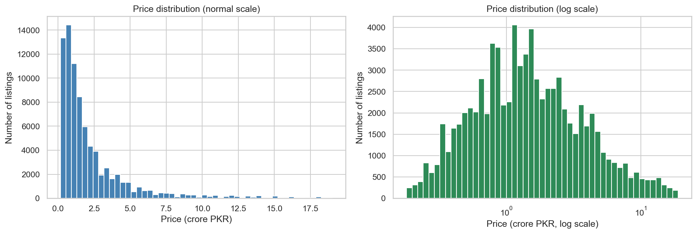

# pakistan-house-price-predictor

Predicts house **sale prices** in Pakistani cities from features such as area, bedrooms, bathrooms, property type and location.

**Status:** Data cleaning and exploratory analysis done. Model training is next.

**Planned pipeline:** trained model, FastAPI backend, Streamlit demo, Next.js frontend deployed on Vercel.

---

## Dataset

- **Source:** [Pakistan House Price Dataset (Kaggle)](https://www.kaggle.com/datasets/jillanisofttech/pakistan-house-price-dataset), based on Zameen.com listings
- **Original size:** 168,446 listings and 20 columns
- **After cleaning:** 80,351 listings
- **Target:** `price` (PKR). Charts show prices in crore (1 crore = 10,000,000 PKR)

---

## Data cleaning

Notebook: [`notebooks/01_eda.ipynb`](notebooks/01_eda.ipynb)

| Step | Rows removed | Why |
|---|---|---|
| Rental listings | 47,791 | Monthly rent and sale price mean different things, so they cannot share one `price` column |
| Duplicate listings | 38,286 | The same listing posted more than once would leak into both the training and test sets |
| Area outliers | 486 | Areas of 0 and up to 12,000 marla are data errors; kept 1 to 100 marla |
| Price outliers | 1,532 | Removed prices outside the 1st to 99th percentile |
| **Total removed** | **88,095** | **80,351 rows kept (47.7%)** |

Other cleaning steps:

- **Area units:** converted Kanal to Marla (1 Kanal = 20 Marla) into one column, `area_marla`, and verified the conversion
- **Dates:** converted `date_added` from text to a real date and added year and month columns
- **Hidden missing values:** zeros in `bedrooms` and `baths` meant "not entered". They were replaced with the median of the same property type, and flag columns record which values were filled
- **Dropped columns:** `agency`, `agent`, `page_url`, `property_id`, `purpose` and the old area columns

The duplicate rule compares every column except the dates. It may also remove some different units in the same project that share price, size and coordinates. I will test a stricter and a milder rule during modelling and compare the results.

---

## Exploratory analysis

Notebook: [`notebooks/02_eda_charts.ipynb`](notebooks/02_eda_charts.ipynb)

### Price distribution

### Price by city

### Price vs area

### Price by number of bedrooms

### Correlation between features

### Price by property type

---

## Key insights

1. **Area is the strongest driver of price.** The correlation between price and `area_marla` is 0.84, higher than bedrooms (0.64) or baths (0.63). Size will carry most of the model's accuracy.
2. **City matters, and a few expensive listings pull averages up.** Islamabad has the highest median price (1.63 crore) and Faisalabad the lowest (0.90 crore). In every city the mean is above the median, and in Islamabad it is about 70% higher (2.77 vs 1.63 crore). I use medians to describe typical prices, and the model should handle the skew, for example by predicting the log of the price.
3. **More bedrooms raise the price, with diminishing returns.** The median rises from 0.38 crore (1 bedroom) to 3.25 crore (6 bedrooms), then stays around 3.5 to 4 crore for 7 to 11 bedrooms. Beyond about 6 bedrooms, area and location matter more.
4. **Two property types dominate the data.** Houses (58,434) and flats (18,765) make up about 96% of the listings, while there are only 18 rooms. The model will learn houses and flats well, and rare types such as rooms will be unreliable.
5. **Bedrooms and baths carry similar information.** Their correlation is 0.83. This can make linear models unstable, so I will compare them with tree-based models. Latitude and longitude show almost no straight-line correlation with price, but the city chart shows location matters, so `city` and `location` will be used as categories.

---

## Tech stack

Python, pandas, NumPy, Matplotlib, Seaborn, scikit-learn, Jupyter. Planned: XGBoost, FastAPI, Streamlit, Next.js, Vercel.

Model

Notebook: notebooks/03_modeling.ipynb | Training script: src/train.py

Features (all things a user can type into a website): property type, city, location, area, bedrooms and baths. Method: the models learn the log of the price. Categories are one-hot encoded, and rare locations (fewer than 30 listings) are grouped together. All scores are measured on 16,071 houses the model never saw during training.

Model comparison
Model	MAE (crore)	RMSE (crore)	R² (price)	Median % error
Dummy baseline (always the typical price)	1.557	2.884	-0.121	60.0%
Linear Regression	0.547	1.137	0.826	18.4%
Random Forest	0.480	1.005	0.864	15.2%
Gradient Boosting	0.475	0.988	0.868	15.4%

Random Forest and Gradient Boosting are almost tied. I deploy Gradient Boosting because it wins on four of five metrics and its saved model is 1.5 MB, compared with 147.6 MB for Random Forest.

Final model results (Gradient Boosting)
Metric	Result
R² (price)	0.868
Median error	15.4%
Mean absolute error	0.475 crore PKR
Predictions within 10% of the real price	33.6%
Predictions within 20% of the real price	60.9%
Predictions within 30% of the real price	77.0%

The API also returns a price range, because one number looks more certain than it is: 80% of real prices fell between 0.72x and 1.39x the prediction.

Evaluation charts (from the Random Forest run in notebook 03)

Model errors Feature importance

Most important features: area (log_area 0.241 and area_marla 0.233, the same information in two forms), then location (city_location 0.132 and city 0.101), then property type (0.053), bedrooms (0.050) and baths (0.032).

Limitations
Very expensive houses (above about 10 crore) are under-predicted
Rare property types such as Penthouse and Farm House have errors above 30%, because there are few examples
The data covers 2018 to 2019, so today's prices are different and the model needs fresh data
The test set is a random split, so similar houses from the same project may appear in both sets
API

Code: api/main.py (FastAPI)

Endpoint	Purpose
GET /	Health check
GET /options	Cities, property types, locations and model scores (for website dropdowns)
POST /predict	Predict the price of one house

Example request:

json
{"property_type": "Flat", "city": "Islamabad", "location": "G-10",
 "area_marla": 5, "bedrooms": 2, "baths": 1}

Example response:

json
{
  "price_pkr": 7702000,
  "price_crore": 0.77,
  "low_pkr": 5538000,
  "high_pkr": 10729000,
  "low_crore": 0.55,
  "high_crore": 1.07,
  "note": null
}

Unknown cities or property types return a clear 422 error, and an unknown location still returns a price with a warning in note.

Project structure
pakistan-house-price-predictor/
├── api/
│   └── main.py               # FastAPI backend
├── data/                     # raw and cleaned CSVs (not tracked by Git)
├── images/                   # charts saved by the notebooks
├── models/
│   ├── house_price_model.joblib   # trained Gradient Boosting pipeline (1.5 MB)
│   └── options.json               # dropdown values, scores and price range
├── notebooks/
│   ├── 01_eda.ipynb          # data cleaning
│   ├── 02_eda_charts.ipynb   # charts and insights
│   └── 03_modeling.ipynb     # model training and evaluation
├── src/
│   ├── house_model.py        # shared feature and prediction code
│   └── train.py              # trains and saves the final model
├── requirements.txt
├── requirements-api.txt
└── README.md

## Author

**Husnain Hassan**, Software Engineering graduate (UMT), aspiring AI engineer
GitHub: [Husnainhassan11](https://github.com/Husnainhassan11)